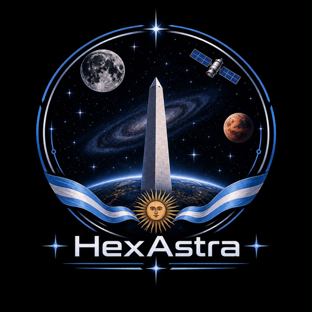

# HexAstra brand guide

This guide is the source of truth for visual identity. Every interface, slide, chart, and project screenshot must follow it. If a design tool suggests another theme, this guide takes precedence: borrow structure, not its palette or typography.

Source assets: the [logo](../assets/brand/hexastra-logo.png) and [cover reference](marca/referencia-portada.jpg). Colors were **measured from these images** on November 14, 2026, rather than selected by eye. Tokens are defined in [`css/brand.css`](../css/brand.css). Asset provenance and publication permissions must be confirmed separately; this guide does not establish their licensing.

## 1. Logo

The mission-patch composition includes the Buenos Aires Obelisk over Earth at night, the Moon and Mars, a satellite, a galaxy, an Argentine-colored ribbon with the Sun of May, and the HexAstra wordmark.

- **Files:** `hexastra-logo.png` (1254 px original), `hexastra-logo-512.png` (web), `apple-touch-icon.png` (180 px), `favicon-64.png`, and `favicon-32.png`.
- **Background:** always `--hx-noche` or black. Do not place it on photographs or light backgrounds.
- **Minimum size:** 96 px wide on screen. Below that, use the HexAstra wordmark in Montserrat 700.
- **Clear space:** at least one quarter of the logo's width on every side.
- **Do not:** crop, distort, recolor, add shadows, or redraw the wordmark in a different typeface.

## 2. Color

### Base palette from the cover

| Token | Hex | Use | Contrast on `--hx-noche` |
|---|---|---|---|
| `--hx-noche` | `#070915` | Overall background | — |
| `--hx-noche-2` | `#121830` | Panels, cards, controls | — |
| `--hx-linea` | `#2A3250` | Dividers and borders | 1.58, decorative |
| `--hx-texto` | `#F6F7FE` | Headings and primary text | 18.56 |
| `--hx-texto-2` | `#A9B0CA` | Secondary text, captions, help | 9.21 |
| `--hx-cian` | `#65D0EA` | Primary accent: subtitles, links, focus, top label | 11.11 |

### Cover network palette

| Token | Hex | Use | Contrast |
|---|---|---|---|
| `--hx-marte` | `#D87E4E` | Mars and high similarity | 6.62 |
| `--hx-violeta` | `#8651D3` | Low similarity and network nodes | 3.90: graphics or text at least 24 px |
| `--hx-cian-brillo` | `#56B2DE` | Network lines, highlights, less-studied sites | 8.33 |

### Logo palette

| Token | Hex | Use | Contrast |
|---|---|---|---|
| `--hx-azul-orbita` | `#2B77E1` | Rings, emphasized borders, large white button text | 4.56: text at least 18 px |
| `--hx-celeste` | `#729CD8` | Earth on maps and legends; modeled data | 7.05 |
| `--hx-sol` | `#D4964E` | Missing data, warnings, physical analogy limits | 7.81 |
| `--hx-luna` | `#B6AEB7` | Moon on maps and legends | 9.19 |

### Color rules

- Keep the application dark, using midnight blue. There is no light theme. Printed brand text may use black on white with one accent.
- Similarity runs from violet to rust orange, never red/green.
- Identify Earth in light blue, Mars in rust, and the Moon in lunar gray. Always include a written name; color is not the only signal.
- Data quality uses cyan for measured, light blue for modeled, and solar gold for pending data, always with a written label.
- Cyan is the single interface accent. Other palette colors have semantic roles and appear only when they communicate that meaning.

## 3. Typography

| Role | Family | Weight/style | Example meaning |
|---|---|---|---|
| Headlines and wordmark | Montserrat | 700 | HexAstra |
| Subtitles | Montserrat | 500, cyan | Earth analogs for the Moon and Mars |
| Top label | Montserrat | 600, uppercase, 0.14 em spacing, cyan | NASA Space Apps / team |
| Text and data | Open Sans | 400 and 600 | Explanation, measurements, units |

Both families are loaded from Google Fonts through `css/brand.css`. Do not introduce a third interface family. Use a single top label per screen rather than one above every heading. Set numeric data in Open Sans 600 with the unit beside the value, and retain its source.

## 4. Imagery and graphics

- **Brand motif:** thin connections between hexagonal nodes over terrain, in bright cyan and violet. Use subtly or to connect Earth and planetary analogs, not as meaningless filler.
- **Photography and satellite imagery:** use real, credited imagery from sources such as NASA, ESA, JAXA, and USGS. Never present AI-generated imagery as scientific data.
- **Maps:** basemaps must work with the dark background. Mark points with the body's color and a cyan selection ring.

## 5. Voice

The application speaks clear English or Rioplatense Spanish, following browser/manual language preference, without unnecessary jargon. Explain what matches, how closely, what differs, and what evidence is missing. Never state an unsourced number. The product purpose is simple: Earth analogs for the Moon and Mars. Documentation is written in English.

## 6. Publication checklist

- [ ] Use the midnight background, cyan accent, and approved palette only.
- [ ] Use Montserrat for headings and Open Sans for text.
- [ ] Preserve the logo on a dark background with clear space.
- [ ] Maintain text contrast of at least 4.5:1; reserve violet and orbit blue for appropriate large text/graphics.
- [ ] Preserve the violet-to-rust score scale and written body/data-quality labels.
- [ ] Keep Earth and destination visible together after selection, following `CLAUDE.md`.
- [ ] Confirm publication rights and retain required attribution for every supplied or external asset.
